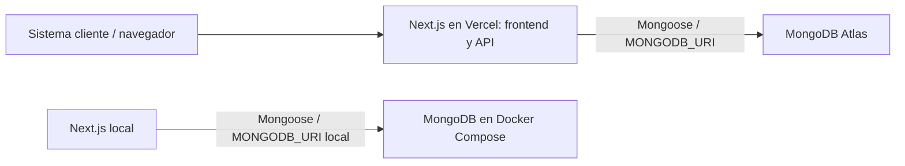
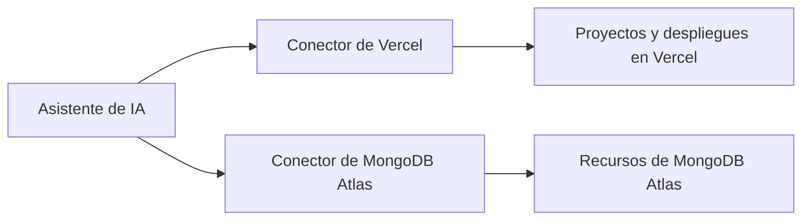

# Arquitectura de FraudLens

FraudLens usa **Vercel** para alojar la aplicación y **MongoDB Atlas** para persistir los datos de producción. Durante el desarrollo usamos MongoDB local con Docker Compose.

## Aplicación y entornos

Un monorepo npm contiene una única aplicación desplegable en `apps/web`. Next.js App Router reúne el frontend React y los endpoints HTTP; las rutas que usan Mongoose se ejecutan con runtime Node.js. Frontend y backend se despliegan juntos en Vercel.

| Entorno | Aplicación | Base de datos | Configuración |
| --- | --- | --- | --- |
| Desarrollo local | Next.js con `npm run dev` | MongoDB 8 con `npm run db:up` | `apps/web/.env.local` |
| Producción | Proyecto `fraudlens` en Vercel | Cluster gratuito M0 `fraudlens` en MongoDB Atlas | Variables del proyecto en Vercel |

La URL de producción es [fraudlens-two.vercel.app](https://fraudlens-two.vercel.app). Atlas aloja la base `fraudlens`; la aplicación utiliza un usuario exclusivo con permisos `readWrite` sobre esa base. `MONGODB_URI` se guarda como variable sensible en Vercel y nunca se publica en el cliente ni se incluye en Git.

## Administración mediante conectores de IA

Usamos los conectores de **Vercel** y **MongoDB Atlas** disponibles en el asistente de IA para interactuar con las cuentas conectadas durante el desarrollo y la operación del proyecto.

- **Conector de Vercel:** permite consultar proyectos y despliegues, configurar variables de entorno, crear despliegues y revisar su estado. Se utilizó para preparar el proyecto y desplegar la aplicación.
- **Conector de MongoDB Atlas:** permite inspeccionar proyectos y clusters y administrar usuarios de base de datos y listas de acceso de red. Se utilizó para configurar el usuario de la aplicación y el acceso desde Vercel. El cluster M0 se creó desde la consola de Atlas porque el conector disponible no ofrecía esa modalidad gratuita.

Los conectores actúan con los permisos de las cuentas conectadas y las autorizaciones del usuario. Son herramientas del asistente para administrar infraestructura; las solicitudes de la aplicación acceden directamente a MongoDB mediante Mongoose. No es necesario que el asistente esté conectado para que FraudLens funcione.

Estos conectores son independientes de **Vercel AI SDK / Groq**, preparados para futuras evaluaciones de IA detrás de un contrato propio. Se conserva también el helper previo de TypeSafe. El endpoint actual devuelve un resultado fijo y no hace inferencia.

## Límites actuales

La pantalla inicial y `/api/health` no acceden a MongoDB ni a TypeSafe. CU-01 (`POST /api/transaction-evaluations`) valida el JSON, llama al servicio de evaluación y persiste un documento TransactionEvaluation mediante connectDB(). Devuelve el ID autogenerado y el resultado fijo solo después de una escritura exitosa. No invoca TypeSafe ni ejecuta reglas.

## Persistencia

`connectDB()` valida `MONGODB_URI` en el servidor, reutiliza la conexión global de Mongoose y comparte la promesa entre llamadas concurrentes. Libera la promesa al finalizar, incluso si falla, para permitir nuevos intentos. Cada instancia de servidor tiene su propio pool (máximo cinco conexiones); no existe un pool global entre funciones de Vercel.

Compose usa un volumen persistente y solo expone MongoDB en loopback. No configura replica set; si un caso de uso requiere transacciones, deberá incorporarse esa configuración. Atlas se administra como servicio externo a Vercel. Para este MVP se autorizó la entrada desde `0.0.0.0/0` para permitir conexiones desde Vercel sin IP de salida fija; las conexiones siguen requiriendo autenticación. Este acceso puede restringirse cuando se disponga de una estrategia de red con egreso fijo.

## IA

La primera etapa usa un puerto propio `DecisionModel`, definido en `src/lib/ai/decision-model.ts`, y un adapter de Groq directo en `src/lib/ai/groq.ts`. `getAiModel()` en `src/lib/ai/index.ts` compone la implementación: solo ahí se elige el proveedor. Los consumidores no importan tipos de Groq ni del AI SDK.

El contrato recibe entrada textual, instrucciones y un esquema de salida aportados por el consumidor. El esquema contiene JSON Schema y una función `parse(unknown)` que valida y devuelve la salida tipada o lanza un error; deben mantenerse coherentes. El adapter usa salida estructurada del AI SDK y rechaza respuestas inválidas. Este puerto no es todavía un servicio de evaluación de fraude: no hay un contrato de decisión de negocio, prompts, reglas ni umbrales nuevos.

`GROQ_API_KEY` se valida solo al pedir la instancia; `GROQ_MODEL` permite elegir otro modelo compatible y usa `openai/gpt-oss-20b` por defecto. Importar, construir o compilar no hace inferencia. Únicamente `decide()` envía una solicitud; tiene timeout de 30 segundos, sin reintentos automáticos ni fallback a resultados inventados. Los errores públicos no exponen mensajes ni cuerpos del proveedor. La configuración está documentada en README, no en `.env.example`, por decisión del usuario.

La inferencia sigue **desconectada de HTTP y MongoDB**. Los tests usan el SDK con transporte HTTP simulado, sin credenciales reales ni consumo de cuota. Una salida válida no prueba calidad predictiva ni calibración. La disponibilidad y cuota gratuita deben confirmarse en la cuenta de Groq; no se hicieron solicitudes reales ni se validó un modelo para fraude.

Se conserva `getDecisionModel()` en `src/lib/ai/typesafe.ts` sin cambios: crea el modelo de decisiones Jev con configuración diferida, pero no implementa el nuevo puerto. Un futuro adapter de TypeSafe deberá traducir ese contrato sin exponer la API experimental al consumidor. No hay selección automática entre proveedores.

## Referencias

- [Next.js App Router](https://nextjs.org/docs/app/getting-started/installation)
- [Mongoose con Next.js](https://mongoosejs.com/docs/nextjs.html)
- [Groq en AI SDK](https://ai-sdk.dev/providers/ai-sdk-providers/groq)
- [Modelos y disponibilidad de Groq](https://console.groq.com/docs/models)
- [TypeSafe en AI SDK](https://ai-sdk.dev/providers/ai-sdk-providers/typesafe-ai)

## CU-01

El contrato y su validación están en `src/server/services/transaction-evaluation-input.ts`; la ruta gestiona HTTP y el servicio coordina la persistencia. El modelo está en `src/server/models/transaction-evaluation.ts`, colección `transaction_evaluations`. Se almacena la entrada completa junto con risk_score, decision, rules_applied y timestamps. Cada solicitud crea una evaluación independiente; no hay deduplicación, autenticación ni motor de reglas en esta etapa.

## Consulta del historial

`GET /api/transaction-evaluations` usa `listTransactionEvaluations()` y la conexión compartida. Un índice compuesto por `created_at` e `_id` descendentes soporta el orden de los resultados. Se pagina con limit (máximo 100) y offset, consultando un documento adicional para calcular `has_more`. La respuesta usa `transaction_evaluation_id`, omite `_id` y `__v`, y lleva `Cache-Control: no-store`.

El usuario autorizó este GET para quienes tengan acceso a la app del MVP, manteniendo la protección existente de Vercel. No se agrega autenticación propia en esta etapa ni se modifica la configuración de protección del despliegue.
