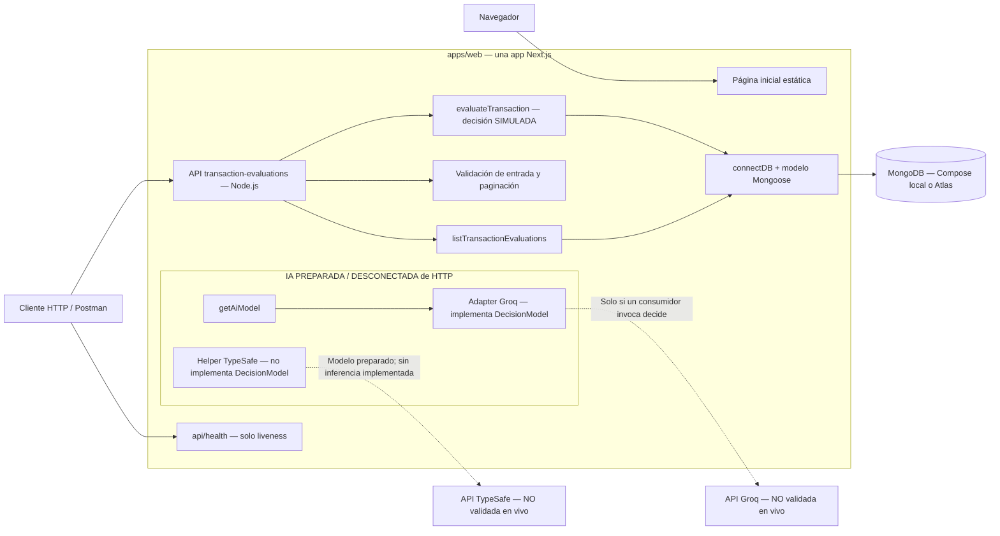
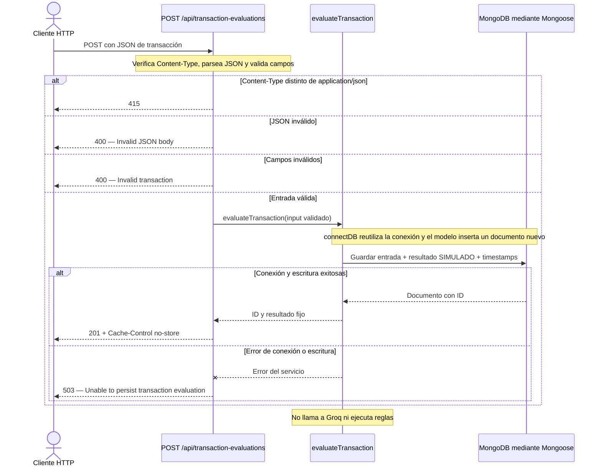
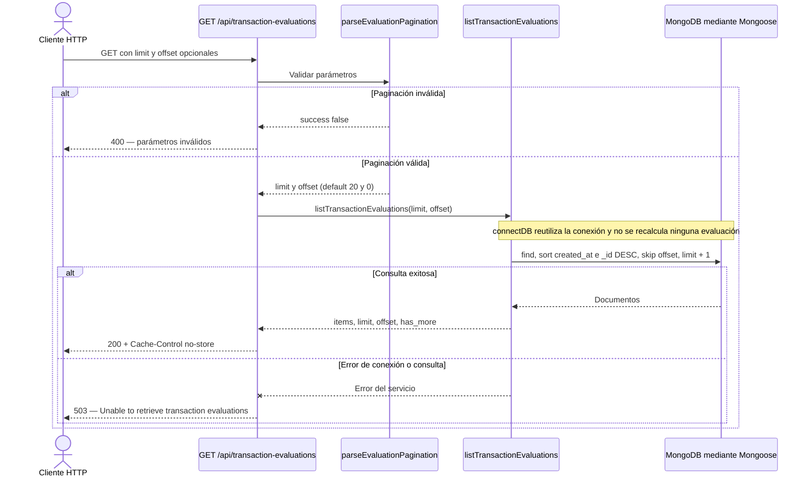
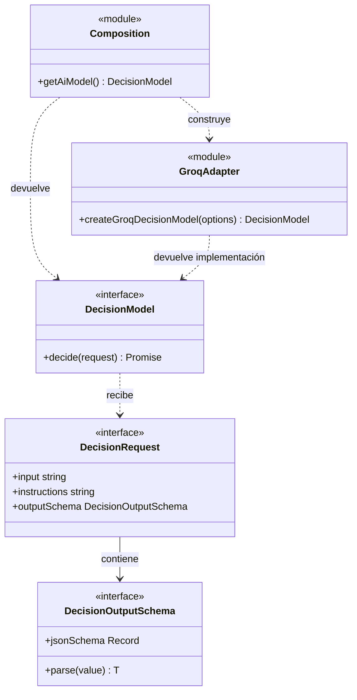
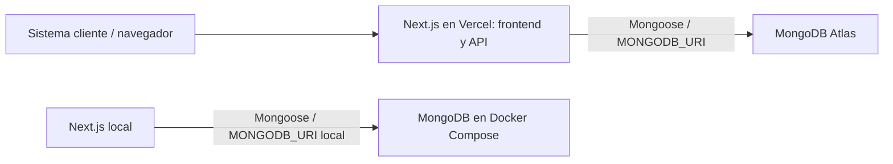
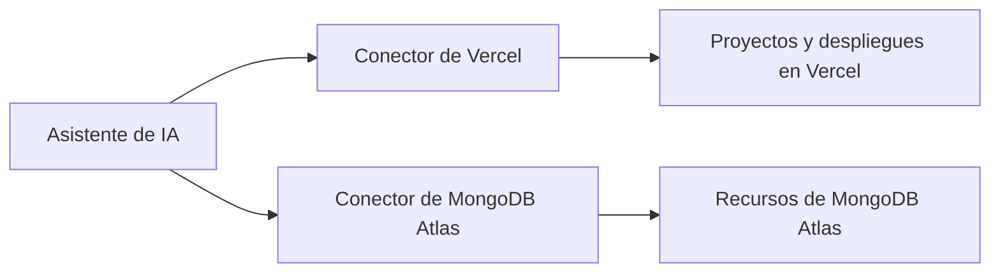

# Arquitectura de FraudLens

FraudLens usa **Vercel** para alojar la aplicación y **MongoDB Atlas** para persistir los datos de producción. Durante el desarrollo usamos MongoDB local con Docker Compose.

## Cómo leer este mapa

Esta página describe el **estado implementado**, tomando como referencia el commit `5c5253a` (adapter Groq sobre transacciones e historial). La documentación de infraestructura es la registrada por el proyecto; este mapa no demuestra que un despliegue o una cuenta externa estén saludables actualmente.

- **Implementado:** código que participa del flujo indicado.
- **Simulado:** código ejecutable que devuelve un resultado fijo, no una evaluación real.
- **Preparado / desconectado:** componente existente sin consumidor en el flujo HTTP.
- **Propuesto:** diseño pendiente, separado en [integración de IA](design/ai-integration.md).

Los diagramas son Mermaid editable, renderizable desde la vista Markdown de GitHub o un visor compatible. El color es complementario: cada componente no operativo lleva su estado escrito.

| Pieza | Estado y límite |
| --- | --- |
| App Next.js | Implementada: una app desplegable, con frontend y API. |
| Pantalla inicial | Implementada: bienvenida estática; no permite crear o consultar evaluaciones. |
| POST de evaluaciones | Implementado: valida y persiste. La decisión es **simulada**. |
| Resultado del POST | Fijo: `risk_score: 0.6`, `decision: "BLOCK"`, `rules_applied: ["block_if_over_50"]`. El nombre de la regla no implica ejecución. |
| GET del historial | Implementado: lectura paginada y ordenada de lo almacenado. |
| MongoDB / Mongoose | Modelo y conexión reutilizable implementados; no se agrega un servicio backend separado. |
| Groq | Preparado / desconectado: adapter con pruebas de HTTP simulado, sin inferencia real verificada. |
| TypeSafe / Jev | Preparado / desconectado: helper anterior, no implementa el puerto nuevo. |
| Health | Implementado: liveness de Next.js, no verifica DB ni IA. |

## Vista 1 — Componentes actuales

Las flechas discontinuas indican una capacidad preparada, no llamadas del endpoint actual. La página inicial no consume la API de evaluaciones. No se representan dashboards, autenticación propia ni motores de reglas porque no están implementados.

**Evidencia:** [rutas](../apps/web/src/app/api/transaction-evaluations/route.ts), [pantalla](../apps/web/src/app/page.tsx), [health](../apps/web/src/app/api/health/route.ts), [servicio de creación](../apps/web/src/server/services/evaluate-transaction.ts), [servicio de consulta](../apps/web/src/server/services/list-transaction-evaluations.ts), [conexión](../apps/web/src/lib/db/mongoose.ts) y [composición de IA](../apps/web/src/lib/ai/index.ts).

## Vista 2 — Crear una evaluación hoy

Los rechazos de contenido o campos ocurren antes de invocar el servicio y no insertan evaluaciones. Cada POST válido que se persiste crea un documento nuevo; no hay deduplicación por `transaction_id`. El campo `decision` del esquema solo admite `BLOCK` actualmente: incorporar otros resultados necesitaría un cambio explícito, no solo conectar un modelo.

**Evidencia:** [ruta POST](../apps/web/src/app/api/transaction-evaluations/route.ts), [validación](../apps/web/src/server/services/transaction-evaluation-input.ts), [servicio](../apps/web/src/server/services/evaluate-transaction.ts) y [esquema persistido](../apps/web/src/server/models/transaction-evaluation.ts).

## Vista 3 — Consultar el historial hoy

`limit` admite enteros entre 1 y 100; `offset`, enteros seguros no negativos. El documento adicional determina `has_more`; no se devuelve como un item extra. Una consulta sin documentos responde `200` con `items: []`. La respuesta transforma `_id` en `transaction_evaluation_id` y excluye `__v`.

**Evidencia:** [ruta GET](../apps/web/src/app/api/transaction-evaluations/route.ts), [paginación](../apps/web/src/server/services/evaluation-pagination.ts) y [consulta](../apps/web/src/server/services/list-transaction-evaluations.ts).

## Vista 4 — Contratos y dependencias de IA

Este UML representa interfaces y módulos, **no clases de negocio nuevas**. El adapter y la composición son funciones que devuelven una implementación del puerto.

El consumidor aporta `input`, `instructions` y `outputSchema`. `decide<T>()` devuelve `Promise<T>` tras validar la respuesta; el esquema contiene JSON Schema y `parse(unknown): T`. El parámetro genérico se resume en el dibujo para mantenerlo legible. No existe todavía un consumidor de negocio conectado a este puerto. El helper TypeSafe queda fuera del UML porque no lo implementa.

**Evidencia:** [contratos](../apps/web/src/lib/ai/decision-model.ts), [composición](../apps/web/src/lib/ai/index.ts), [adapter](../apps/web/src/lib/ai/groq.ts) y [helper TypeSafe](../apps/web/src/lib/ai/typesafe.ts).

## Evidencia y límites de verificación

En la preparación del adapter pasó `npm run check`: lint, 14 tests aprobados, un test HTTP omitido por no configurar `TEST_BASE_URL`, tipos y build. Los tests del adapter usan el SDK con HTTP simulado; no demuestran credenciales, cuota, disponibilidad o calidad predictiva. Este mapa no vuelve a probar Atlas, Vercel ni Groq. Los diagramas describen código, no una prueba en vivo del sistema desplegado.

Se verificó el render de los siete bloques Mermaid de esta página y del diseño de integración con Mermaid `11.12.0` en navegador: siete SVG generados y captura completa inspeccionada. Se corrigieron dos notas de secuencia cuyo punto y coma rompía el parser. Esta comprobación visual no sustituye las pruebas funcionales ni valida servicios externos. No se generó una exportación HTML de Archify.

Ver los [tests del adapter](../apps/web/tests/groq.test.mjs), [tests de validación](../apps/web/tests/transaction-evaluation-input.test.mjs), [tests de paginación](../apps/web/tests/evaluation-pagination.test.mjs) y [test HTTP opcional](../apps/web/tests/transaction-evaluations.integration.test.mjs).

## Aplicación y entornos

Un monorepo npm contiene una única aplicación desplegable en `apps/web`. Next.js App Router reúne el frontend React y los endpoints HTTP; las rutas que usan Mongoose se ejecutan con runtime Node.js. Frontend y backend se despliegan juntos en Vercel.

| Entorno | Aplicación | Base de datos | Configuración |
| --- | --- | --- | --- |
| Desarrollo local | Next.js con `npm run dev` | MongoDB 8 con `npm run db:up` | `apps/web/.env.local` |
| Producción | Proyecto `fraudlens` en Vercel | Cluster gratuito M0 `fraudlens` en MongoDB Atlas | Variables del proyecto en Vercel |

La URL de producción es [fraudlens-two.vercel.app](https://fraudlens-two.vercel.app). Atlas aloja la base `fraudlens`; la aplicación utiliza un usuario exclusivo con permisos `readWrite` sobre esa base. `MONGODB_URI` se guarda como variable sensible en Vercel y nunca se publica en el cliente ni se incluye en Git.

## Administración mediante conectores de IA

Usamos los conectores de **Vercel** y **MongoDB Atlas** disponibles en el asistente de IA para interactuar con las cuentas conectadas durante el desarrollo y la operación del proyecto.

- **Conector de Vercel:** permite consultar proyectos y despliegues, configurar variables de entorno, crear despliegues y revisar su estado. Se utilizó para preparar el proyecto y desplegar la aplicación.
- **Conector de MongoDB Atlas:** permite inspeccionar proyectos y clusters y administrar usuarios de base de datos y listas de acceso de red. Se utilizó para configurar el usuario de la aplicación y el acceso desde Vercel. El cluster M0 se creó desde la consola de Atlas porque el conector disponible no ofrecía esa modalidad gratuita.

Los conectores actúan con los permisos de las cuentas conectadas y las autorizaciones del usuario. Son herramientas del asistente para administrar infraestructura; las solicitudes de la aplicación acceden directamente a MongoDB mediante Mongoose. No es necesario que el asistente esté conectado para que FraudLens funcione.

Estos conectores son independientes de **Vercel AI SDK / Groq**, preparados para futuras evaluaciones de IA detrás de un contrato propio. Se conserva también el helper previo de TypeSafe. El endpoint actual devuelve un resultado fijo y no hace inferencia.

## Límites actuales

La pantalla inicial y `/api/health` no acceden a MongoDB ni a TypeSafe. CU-01 (`POST /api/transaction-evaluations`) valida el JSON, llama al servicio de evaluación y persiste un documento TransactionEvaluation mediante connectDB(). Devuelve el ID autogenerado y el resultado fijo solo después de una escritura exitosa. No invoca TypeSafe ni ejecuta reglas.

## Persistencia

`connectDB()` valida `MONGODB_URI` en el servidor, reutiliza la conexión global de Mongoose y comparte la promesa entre llamadas concurrentes. Libera la promesa al finalizar, incluso si falla, para permitir nuevos intentos. Cada instancia de servidor tiene su propio pool (máximo cinco conexiones); no existe un pool global entre funciones de Vercel.

Compose usa un volumen persistente y solo expone MongoDB en loopback. No configura replica set; si un caso de uso requiere transacciones, deberá incorporarse esa configuración. Atlas se administra como servicio externo a Vercel. Para este MVP se autorizó la entrada desde `0.0.0.0/0` para permitir conexiones desde Vercel sin IP de salida fija; las conexiones siguen requiriendo autenticación. Este acceso puede restringirse cuando se disponga de una estrategia de red con egreso fijo.

## IA

La primera etapa usa un puerto propio `DecisionModel`, definido en `src/lib/ai/decision-model.ts`, y un adapter de Groq directo en `src/lib/ai/groq.ts`. `getAiModel()` en `src/lib/ai/index.ts` compone la implementación: solo ahí se elige el proveedor. Los consumidores no importan tipos de Groq ni del AI SDK.

El contrato recibe entrada textual, instrucciones y un esquema de salida aportados por el consumidor. El esquema contiene JSON Schema y una función `parse(unknown)` que valida y devuelve la salida tipada o lanza un error; deben mantenerse coherentes. El adapter usa salida estructurada del AI SDK y rechaza respuestas inválidas. Este puerto no es todavía un servicio de evaluación de fraude: no hay un contrato de decisión de negocio, prompts, reglas ni umbrales nuevos.

`GROQ_API_KEY` se valida solo al pedir la instancia; `GROQ_MODEL` permite elegir otro modelo compatible y usa `openai/gpt-oss-20b` por defecto. Importar, construir o compilar no hace inferencia. Únicamente `decide()` envía una solicitud; tiene timeout de 30 segundos, sin reintentos automáticos ni fallback a resultados inventados. Los errores públicos no exponen mensajes ni cuerpos del proveedor. La configuración está documentada en README, no en `.env.example`, por decisión del usuario.

La inferencia sigue **desconectada de HTTP y MongoDB**. Los tests usan el SDK con transporte HTTP simulado, sin credenciales reales ni consumo de cuota. Una salida válida no prueba calidad predictiva ni calibración. La disponibilidad y cuota gratuita deben confirmarse en la cuenta de Groq; no se hicieron solicitudes reales ni se validó un modelo para fraude.

Se conserva `getDecisionModel()` en `src/lib/ai/typesafe.ts` sin cambios: crea el modelo de decisiones Jev con configuración diferida, pero no implementa el nuevo puerto. Un futuro adapter de TypeSafe deberá traducir ese contrato sin exponer la API experimental al consumidor. No hay selección automática entre proveedores.

## Referencias

- [Next.js App Router](https://nextjs.org/docs/app/getting-started/installation)
- [Mongoose con Next.js](https://mongoosejs.com/docs/nextjs.html)
- [Groq en AI SDK](https://ai-sdk.dev/providers/ai-sdk-providers/groq)
- [Modelos y disponibilidad de Groq](https://console.groq.com/docs/models)
- [TypeSafe en AI SDK](https://ai-sdk.dev/providers/ai-sdk-providers/typesafe-ai)

## CU-01

El contrato y su validación están en `src/server/services/transaction-evaluation-input.ts`; la ruta gestiona HTTP y el servicio coordina la persistencia. El modelo está en `src/server/models/transaction-evaluation.ts`, colección `transaction_evaluations`. Se almacena la entrada completa junto con risk_score, decision, rules_applied y timestamps. Cada solicitud crea una evaluación independiente; no hay deduplicación, autenticación ni motor de reglas en esta etapa.

## Consulta del historial

`GET /api/transaction-evaluations` usa `listTransactionEvaluations()` y la conexión compartida. Un índice compuesto por `created_at` e `_id` descendentes soporta el orden de los resultados. Se pagina con limit (máximo 100) y offset, consultando un documento adicional para calcular `has_more`. La respuesta usa `transaction_evaluation_id`, omite `_id` y `__v`, y lleva `Cache-Control: no-store`.

El usuario autorizó este GET para quienes tengan acceso a la app del MVP, manteniendo la protección existente de Vercel. No se agrega autenticación propia en esta etapa ni se modifica la configuración de protección del despliegue.
