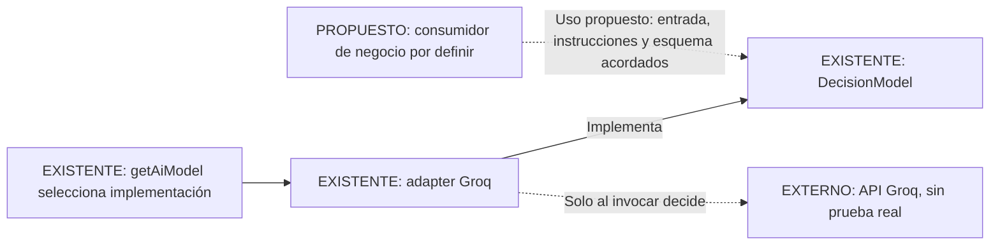

# Diseño de integración de IA — estado y decisiones pendientes

**Estado:** planificación; no modifica el comportamiento de la aplicación.
**Base técnica:** commit `5c5253a`, con adapter Groq preparado y desconectado de HTTP.

Ver primero el [mapa de arquitectura actual](../architecture.md): distingue componentes implementados, resultados simulados y capacidades desconectadas.

## Objetivo acordado

Poder cambiar de modelo o proveedor sin acoplar los servicios de negocio a una API externa. El proveedor inicial elegido para la preparación técnica es Groq, buscando una modalidad con requests gratuitos; no es una elección definitiva del modelo de fraude ni una garantía de cuota.

El alcance implementado hasta ahora es interfaz propia, adapter, configuración y pruebas simuladas. No se autorizó con esa etapa inventar un esquema de fraude, prompts de negocio, reglas, umbrales o nuevos puntajes. El POST conserva su resultado fijo.

## Qué existe y qué falta

| Aspecto | Existe | Falta decidir o comprobar |
| --- | --- | --- |
| Contrato técnico | `DecisionModel.decide<T>()` con entrada, instrucciones y salida validada. | La tarea de negocio que lo consumirá y su entrada/salida concreta. |
| Proveedor inicial | Adapter Groq directo y modelo configurable. | Acceso y cuota de la cuenta, disponibilidad y prueba real autorizada. |
| Reemplazo del proveedor | Un único punto de composición en `getAiModel()`. | Implementar otro adapter y comprobar equivalencia antes de seleccionarlo. |
| TypeSafe | Helper previo conservado. | Adapter al contrato propio, si se decide usarlo; no hay fallback automático. |
| Evaluación HTTP | POST valida, persiste y devuelve un resultado fijo. | Si la primera función de IA debe intervenir en este recorrido o tener otro. |
| Salida estructurada | JSON Schema y `parse` aportados por el consumidor; respuestas inválidas se rechazan. | Ejemplos y criterios de utilidad/corrección de la salida de negocio. |
| Fallos técnicos | Timeout de 30 segundos, sin reintentos automáticos y errores saneados. | Qué debe hacer el caso de uso frente a un fallo, sin fabricar una decisión. |
| Persistencia | Colección de evaluaciones con decisión fija y timestamps. | Si la nueva capacidad requiere almacenar algo distinto. No se proponen cambios de esquema todavía. |

**Importante:** una salida que cumple el esquema no demuestra que sea verdadera. Una confianza expresada por un LLM no es una probabilidad calibrada de fraude.

## Límite del puerto actual

`DecisionModel` es un puerto de **inferencia estructurada**, no un servicio de negocio antifraude. Recibe las instrucciones y el esquema que debe definir un consumidor futuro. No decide por sí mismo qué significa fraude ni cómo convertir una respuesta en `risk_score` o `decision`.

El puerto evita tipos de proveedor en el consumidor. No garantiza que dos modelos tengan la misma calidad, semántica o soporte de JSON Schema. Cambiar `GROQ_MODEL` o implementar otro adapter exige volver a verificar el comportamiento acordado.

### Vista propuesta — conectar una capacidad, no un endpoint por defecto

Este dibujo no incorpora un nuevo servicio desplegable, endpoint, entidad ni cambio de MongoDB. El consumidor es una responsabilidad pendiente de definir, no una implementación aprobada. El diagrama de secuencia futuro se completará cuando se acuerden su tarea y el tratamiento del resultado.

## Decisiones antes de conectar inferencia real

| Decisión | Pregunta concreta | Por qué importa |
| --- | --- | --- |
| Tarea | ¿Qué necesita lograr el usuario con esta primera función? | Distingue asistencia, explicación o hipótesis de una decisión automática. No se elige una aquí. |
| Entrada | ¿Qué datos se necesitan y cuáles pueden enviarse al proveedor? | Evita enviar datos sensibles o exigir datos que la app no tiene. |
| Salida | ¿Qué respuesta concreta es útil y cómo se valida? | Permite definir el contrato de negocio sin copiar el formato de Groq. |
| Incertidumbre | ¿Cómo debe responder cuando los datos no alcanzan? | Impide completar información o fabricar certeza. |
| Fallo | ¿Se interrumpe el caso de uso, queda pendiente o interviene una persona? | Es una decisión de producto; el adapter solo informa que falló. |
| Integración | ¿Se usa el POST actual o un recorrido separado? | Conectar el POST también exige resolver qué pasa con el stub y el esquema que solo admite `BLOCK`. |
| Evaluación | ¿Qué ejemplos demostrarán que sirve? | Separa cumplir JSON de acertar una tarea real. |

## Plan por entregables

### A. Hacer visible el estado actual

- Mantener el inventario y las cuatro vistas de componentes, POST, GET y contratos de IA.
- Enlazar cada responsabilidad con el código que la implementa.
- Conservar la distinción entre simulado, desconectado y propuesto.

**Criterio de cierre:** el equipo puede seguir una solicitud e identificar dónde termina la implementación real y dónde empieza una propuesta.

### B. Acordar una sola capacidad de negocio

- Elegir una tarea y describir quién la necesita y para qué.
- Aportar ejemplos sintéticos de entrada y respuesta esperada.
- Definir datos permitidos, límites, incertidumbre y fallos.

**Criterio de cierre:** el equipo aprueba el contrato y ejemplos suficientes para escribir pruebas. No alcanza con elegir un proveedor.

### C. Diseñar y probar ese recorrido

- Completar una secuencia propuesta, separada de las secuencias actuales.
- Escribir primero pruebas del comportamiento acordado con un modelo simulado.
- Usar el puerto existente; modificarlo solo si los ejemplos muestran una necesidad concreta.
- Realizar una solicitud real únicamente con autorización y datos sintéticos; no registrar credenciales ni contenido sensible.

**Criterio de cierre:** los ejemplos aprobados pasan y queda documentado qué se verificó con mocks y qué se comprobó contra el proveedor.

### D. Integrar y entregar

- Conectar HTTP o persistencia solo si forman parte del alcance aprobado.
- Actualizar Postman si cambia un endpoint y ejecutar las verificaciones aplicables.
- Publicar el avance y las evidencias en la tarjeta correspondiente de Trello, sin dar por terminados los pendientes del equipo sobre datos, métricas o elección definitiva del modelo.

**Criterio de cierre:** el recorrido elegido funciona de punta a punta y el equipo puede revisar sus límites y evidencia.

## Fuera de esta planificación

No se agregan autenticación, dashboards, entrenamiento de un modelo tabular, nuevas reglas, scores, umbrales, reintentos, fallbacks ni modificaciones de infraestructura. Tampoco se confirma un uso de datos reales por un proveedor gratuito. Cualquiera de esos cambios requiere un alcance propio.

## Herramientas para mantener los diagramas

Mermaid es la fuente editable dentro del repositorio. El inventario personal de herramientas identifica `archify` para HTML explorable y `diagram-design` para diagramas estáticos de estilo editorial. Archify está disponible en la sesión que preparó este mapa; no se instaló ni ejecutó el plugin de diagram-design.

Una versión HTML con Archify es un complemento opcional, no un requisito para modificar la app. Si se genera con referencias al código, debe usar un commit identificado: no atribuir cambios locales sin commit a una versión publicada. Los renders visuales deben verificarse y reportarse por separado de la revisión del Markdown.
